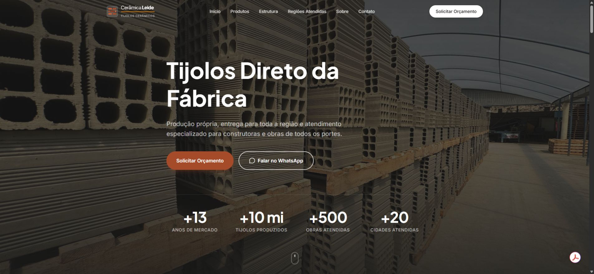

# Cerâmica Leide — Business Website

A responsive website for a brick manufacturer, built with Next.js, TypeScript, and Tailwind CSS.



Business website home page.

[Visit the website](https://www.ceramicaleide.com.br)

## What problem did I solve?

A potential customer needs to understand the products, check whether the company serves their region, and find a direct way to request a quote. I organized that information into one site with clear product sections, manufacturing context, service-area information, frequently asked questions, and contact links.

## What is included?

- Product information for 8-hole, 12-hole, and 16-hole bricks.
- Factory and manufacturing-process sections.
- Service regions and an interactive map.
- Responsive navigation and direct contact actions.
- Page metadata and a static export suitable for conventional hosting.

## How do I know my solution works?

The production build passes and produces a static site in `out/`. A post-build check verifies that the exported home page has working internal anchor targets, a canonical URL, and the local images it references. TypeScript validation and the export check run in GitHub Actions.

These checks cover the delivered files and navigation structure. They do not measure customer conversion, prove commercial claims, or replace a manual mobile and contact-link review. I have not claimed sales or traffic improvements without analytics.

## Run locally

Requires Node.js 22 and npm.

```bash
npm ci
npm run dev
```

Open http://localhost:3000.

```bash
npm run typecheck
npm run build
npm run test:export
```

## Deploy

The app uses `output: "export"` and generates `out/`. Upload that directory to a static host. Preview it with a local static server, for example:

```bash
python -m http.server 8080 --directory out
```

The static export does not use `next start`. It has no booking, checkout, or application database.

## Maintain the content

Business constants and contact settings are in `src/lib/constants.ts`. Product and section content lives under `src/data/` and the page components. Image naming and replacement instructions are in [public/images/README.md](public/images/README.md).

The customer-facing site is in Portuguese. Repository documentation is in English. Keep commercial specifications and contact details confirmed with the business when updating them.
